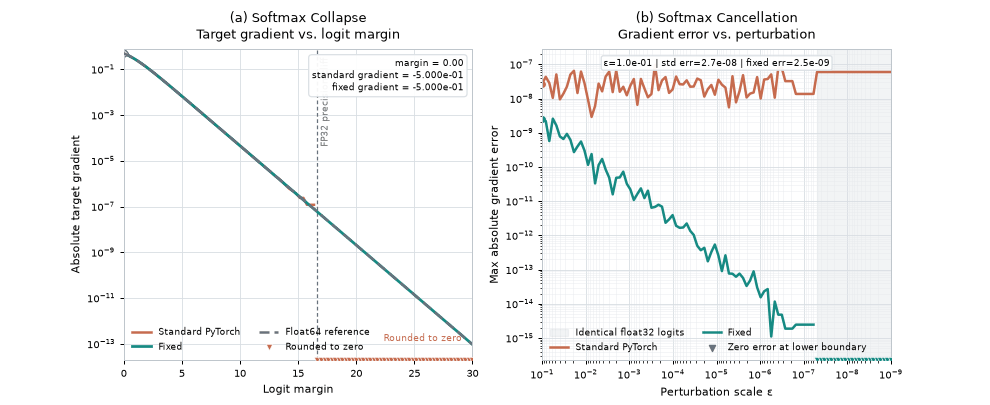

# Fixed Softmax & Cross-Entropy

*A minimal PyTorch implementation of numerically corrected softmax and cross-entropy.*

This repository independently implements the numerical fixes described in [A Fix for Softmax and Cross-Entropy](https://arxiv.org/abs/2610.31642) by Jonathan T. Barron, Dan Gnanapragasam, and Michael Tschannen. The formulas in that paper are the source of the algorithms here; this project is independent and is not maintained or endorsed by the authors.

## Overview

Conventional softmax and cross-entropy can lose small but meaningful gradients in two cases: when a hard-target prediction is extremely confident, and when student and teacher distributions in distillation are almost equal. These are floating-point evaluation problems; the mathematical objectives remain the usual softmax and cross-entropy.

This package changes how those objectives are evaluated. It exposes four stateless functions, keeps the implementation in one small module, and uses ordinary PyTorch operations and autograd.

### Visualization

The animation below illustrates the two numerical issues addressed by this repository.



**Left: Softmax Collapse.** As the logit margin increases, the target gradient computed by standard cross-entropy eventually rounds to zero. The fixed implementation preserves the small gradient and follows the high-precision reference.

**Right: Softmax Cancellation.** When student and teacher logits become nearly identical, conventional soft-target cross-entropy may suffer from cancellation errors. The fixed implementation computes more accurate gradients and returns exactly zero for identical logits.

This is an independent visualization generated directly using this repository's PyTorch implementations. It is inspired by the [official interactive demo](https://jonbarron.info/softmaxfix/demo.html).

Regenerate the visualization with:

    pip install -e ".[viz]"
    python examples/make_visualization.py

The experiments run on CPU without external datasets. Numerical behavior may vary with PyTorch versions and execution backends.

## The Problems

### Softmax Collapse

For target class $t$, define the margin against all other classes as

\[
m = z_t - \log\sum_{j\ne t} e^{z_j}.
\]

The exact target gradient for hard-target cross-entropy is

\[
g_t = q_t - 1 = -\frac{e^{-m}}{1+e^{-m}}.
\]

The usual `q_t - 1` computation subtracts one from a probability that may already have rounded to exactly one. Once `1 + exp(-m)` rounds to `1`, the target gradient becomes zero. Non-target gradients are evaluated from their small exponential numerators and can remain nonzero, so the gradient no longer sums to zero. The approximate cliffs are 5.5 for bfloat16, 16.6 for float32, and 36.7 for float64.

For example, with float32 logits `[9, -9, -9]` and target `0`, common standard implementations can return zero loss and a zero target gradient. The exact loss is about `3.046e-8`; its gradient is approximately `[-3.046e-8, 1.523e-8, 1.523e-8]`. The remaining gradient entries can pull against the missing target entry, which can affect adaptive optimizers when the example's margin crosses the precision cliff.

### Softmax Cancellation

In distillation, let $p=\operatorname{softmax}(z_T)$ be the teacher distribution and $q=\operatorname{softmax}(z_S)$ be the student distribution. The soft-target cross-entropy and its student gradient are

\[
L=-\sum_k p_k\log q_k, \qquad g=q-p.
\]

When student and teacher logits are close, computing two rounded probability vectors and subtracting them loses precision. Different operation sequences in the forward and backward passes can also leave a small nonzero gradient when the logits are identical, even though the exact gradient is zero. This may cause a distilled student to drift from its teacher.

The paper's example uses teacher logits `[2, 1, 0]` and adds `[-1e-7, 1e-7, 0]` to form the student logits. In float32, the corrected gradient is approximately `[-4.596e-8, 4.144e-8, 4.513e-9]`; separately rounded probabilities can produce a noticeably different vector.

## The Fixes

| Problem | Standard computation | Corrected computation |
| --- | --- | --- |
| Softmax Collapse | Subtracting one from a rounded probability | Target-relative margin and stable Softplus |
| Softmax Cancellation | Subtracting close probabilities | Logit differences with `expm1` and `log1p` |

For `fixed_log_softmax`, the maximum logit is shifted to a constant zero and excluded from the LogSumExp. The remaining logits determine the margin. The log-probability correction uses `F.logsigmoid(margin)`, while hard-target cross-entropy uses its negative, `-F.logsigmoid(margin)`. These expressions are mathematically equivalent to the Softplus form and preserve the small-tail gradient in eager and TorchScript execution. Hard-target cross-entropy uses the target logit in place of the maximum, so autograd obtains the target gradient as the negative sum of the non-target gradients.

For soft targets, the student-teacher logit difference is centered under the teacher probabilities. The resulting log probability ratio is evaluated with `expm1` and `log1p`, avoiding subtraction of nearly equal probabilities. A final correction removes residual gradient-sum drift. See [docs/numerics.md](docs/numerics.md) for derivations and precision details.

## Installation

```bash
pip install -e .
```

For development:

```bash
pip install -e ".[dev]"
```

PyTorch is the only runtime dependency; pytest is the only development dependency.

## Quick Start

```python
import torch

from fixed_softmax_cross_entropy import (
    fixed_softmax,
    fixed_log_softmax,
    fixed_cross_entropy,
    fixed_soft_target_cross_entropy,
)

logits = torch.randn(4, 10, requires_grad=True)
targets = torch.randint(0, 10, (4,))

loss = fixed_cross_entropy(logits, targets)
loss.backward()
```

For distillation, pass teacher logits rather than teacher probabilities:

```python
student = torch.randn(4, 10, requires_grad=True)
teacher = torch.randn(4, 10)

loss = fixed_soft_target_cross_entropy(student, teacher)
loss.backward()
```

The function does not take a temperature argument. Apply temperature to both inputs yourself, and multiply the result by $T^2$ if that is part of your distillation objective:

```python
temperature = 2.0
loss = temperature**2 * fixed_soft_target_cross_entropy(
    student / temperature,
    teacher / temperature,
)
```

Teacher logits remain connected to the forward objective when they require gradients. Detach them when the teacher is frozen.

## API Reference

All functions reduce classes over the final dimension. Inputs must be finite floating-point tensors with at least two classes and matching device/dtype where applicable. Shapes may include any number of batch dimensions.

| Function | Inputs | Output |
| --- | --- | --- |
| `fixed_log_softmax(logits)` | `[..., C]` floating-point logits | Log-probabilities with shape `[..., C]` |
| `fixed_softmax(logits)` | `[..., C]` floating-point logits | Probabilities with shape `[..., C]` |
| `fixed_cross_entropy(logits, targets, reduction="mean")` | Logits `[..., C]`; integer targets `[...]` | Per-sample losses for `"none"`, otherwise scalar |
| `fixed_soft_target_cross_entropy(student_logits, teacher_logits, reduction="mean")` | Matching student and teacher logits `[..., C]` | Per-sample losses for `"none"`, otherwise scalar |

Hard-target and soft-target cross-entropy support `"none"`, `"mean"`, and `"sum"` reductions. The soft-target function substitutes a stabilized first-order student gradient; higher-order derivatives through that gradient are not supported.

## Numerical Verification

The test suite covers the paper's collapse and cancellation examples, precision cliffs, zero-sum gradients, ordinary-input equivalence, float64 gradient checking, reductions, and teacher-gradient behavior. Run:

```bash
pytest -q
python examples/compare.py
```

The comparison script uses CPU tensors and no downloaded datasets. It prints actual results from the installed PyTorch version; the standard implementation's behavior may vary by version and backend. The fixed hard-target gradient remains nonzero while representable, and identical student and teacher logits produce an exactly zero student gradient in the tested case.

## Limitations

- This is a correctness-first reference implementation, not a fused or performance-optimized kernel. Standard PyTorch kernels may be faster.
- There is no automatic dtype promotion. Accuracy depends on the dtype used for the actual operations; representative bfloat16 support does not imply better results than every fused low-precision kernel.
- Gradients eventually underflow when they become too small to represent.
- Only the API and reductions listed above are supported. There is no `ignore_index`, class weighting, label smoothing, probability-target hard CE, arbitrary class dimension, or masked negative-infinity input support.
- The soft-target gradient substitution is intended for first-order differentiation. `torch.compile` behavior has not been separately validated.
- Device and kernel differences can affect floating-point results. The fixes are not guaranteed to improve every model or training workload.
- This repository reproduces numerical examples and tests; it does not reproduce the paper's full grokking experiments.

## References

The numerical algorithms are based on the work of Jonathan T. Barron, Dan Gnanapragasam, and Michael Tschannen:

```bibtex
@misc{barron2026fixsoftmaxcrossentropy,
  title         = {A Fix for Softmax and Cross-Entropy},
  author        = {Barron, Jonathan T. and Gnanapragasam, Dan and Tschannen, Michael},
  year          = {2026},
  eprint        = {2610.31642},
  archivePrefix = {arXiv},
  primaryClass  = {cs.LG},
  url           = {https://arxiv.org/abs/2610.31642}
}
```

- [Original paper](https://arxiv.org/abs/2610.31642)
- [Official reference implementation](https://jonbarron.info/softmaxfix/)
- [Independent PyTorch implementation](https://github.com/PwnerHarry/barron-softmax-fix)

## License

This project is distributed under the [MIT License](LICENSE).
